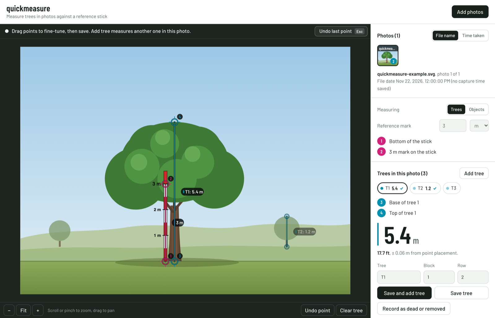

# quickmeasure

**Tree heights from photos with a reference stick.**

[**Open quickmeasure**](https://matthewwdavis.github.io/quickmeasure/) · [**Download it** (one HTML file)](https://github.com/matthewwdavis/quickmeasure/releases/latest/download/quickmeasure.html) · [How to cite](#citing-quickmeasure)

<picture>
  <source media="(prefers-color-scheme: dark)" srcset="docs/screenshot_dark.png">
  
</picture>

quickmeasure measures the height of trees, or anything else that stands upright, in ordinary photos. Stand a stick with a known mark (say 3 m) against the trunk and take a photo. Then click four points: the bottom of the stick, its mark, the base of the tree and the top of the tree. quickmeasure scales the tree by the stick and gives the height, with a ± for how precisely the points were placed.

It is a single web page that runs entirely in your browser. Photos are never uploaded anywhere, and the downloaded file works offline.

## Getting it

- **Use it online:** https://matthewwdavis.github.io/quickmeasure/
- **Download it:** [quickmeasure.html](https://github.com/matthewwdavis/quickmeasure/releases/latest/download/quickmeasure.html) is the whole app in one file. Open it in any current browser (Chrome, Edge, Firefox or Safari), with or without an internet connection.
- **From this repository:** `index.html` is the same file.

To practise, click **Try an example** on the start screen. It loads a drawing of a tree 5.4 m tall with a stick marked at 3 m. The same drawing is in [`examples/example_tree.jpg`](examples/example_tree.jpg) if you want to try adding a photo yourself.

## Taking the photos

- Stand the stick upright right against the trunk. If it's closer to the camera than the tree, the height comes out too low; if it's farther away, too high.
- Shoot from well back, ideally at least as far from the tree as it is tall, and hold the camera level.
- Get the whole tree and the stick's mark in the frame. The stick should span at least 80 pixels; quickmeasure warns you when it doesn't.
- On wide, rounded crowns the highest point you can see is often in front of the true top, so heights tend to read low.
- You can measure several trees in one photo, but each needs to be about as far from the camera as the stick is. Trees farther back come out too short.

## Measuring

1. **Add photos** (or drop them on the page). Sort them by file name or by the time taken, read from the photo's camera data.
2. Set the **reference mark** to the length of the mark you'll click on the stick, in m, cm or ft.
3. Click the **bottom of the stick**, where it meets the ground, then the **reference mark**.
4. Click the **base of the tree** at ground level, then its **very top**. The height appears straight away.
5. Zoom in (scroll, pinch, or **+**) and drag any point to fine-tune it. A magnifier and a level guide line follow the point.
6. Fill in **Tree**, **Block** and **Row** and click **Save and add tree** (another tree in the same photo) or **Save and next photo**. Trees that are gone can be recorded with **Record as dead or removed**.
7. When you're done, **Download CSV** or **Copy for spreadsheet**, and **Save session** to keep every point you placed.

**Measuring: Trees / Objects** switches the wording for things that aren't trees. In object mode the fields are ID, Group and Row.

Keyboard: <kbd>Esc</kbd>, <kbd>Z</kbd> or <kbd>Backspace</kbd> undo the last point · <kbd>A</kbd> adds a tree · <kbd>F</kbd> fits the photo · <kbd>+</kbd> / <kbd>-</kbd> zoom · <kbd>←</kbd> / <kbd>→</kbd> previous / next photo.

## How the height is worked out

The stick and the tree are taken to stand at the same distance from the camera, so one scale (pixels per metre) applies to both:

```
height = (tree length in pixels / stick length in pixels) × reference mark
```

Each length is the straight-line distance between its two points, in the photo's own pixels, so it doesn't depend on how far you've zoomed in. The reference mark is converted to metres first (1 ft = 0.3048 m).

The **±** comes only from where the points were placed. Each point is given an uncertainty of `max(0.75, 1.5 / zoom)` photo pixels, where `zoom` is screen pixels per photo pixel when the point was placed or last moved, so zooming in before clicking makes it smaller. The two ends of each length combine in quadrature, and the stick's and tree's relative uncertainties combine the same way:

```
± = height × √[ (e₁² + e₂²) / stick² + (e₃² + e₄²) / tree² ]
```

The ± doesn't include errors from the setup: a stick nearer to or farther from the camera than the tree, a leaning stick or tree, a top hidden behind the crown, or lens distortion near the edges of the frame. See [Taking the photos](#taking-the-photos).

## What you get out

**CSV** (`tree-heights-<date>.csv`, or `heights-<date>.csv` in object mode), one row per saved tree:

| Column | What it holds |
|---|---|
| `Tree`, `Block`, `Row` | What you typed (`ID`, `Group`, `Row` in object mode) |
| `Height_m`, `Height_ft` | The height, to 0.01 |
| `Error_m` | The ± in metres |
| `Status` | `measured`, or `dead_or_removed` (`missing_or_removed` in object mode) |
| `Photo` | The photo's file name |
| `Photo_taken`, `Photo_time_source` | When the photo was taken, as the camera's local time; `camera` if it came from the photo's camera data, `file_date` if from the file's date |
| `Reference`, `Reference_unit`, `Reference_m` | The reference mark as entered, and in metres |
| `Stick_px`, `Tree_px` | The two lengths the height comes from, in photo pixels |
| `Saved_at` | When the row was saved (UTC) |
| `quickmeasure_version` | The version that measured it |

**Session file** (`quickmeasure-session-<date>.json`) holds everything needed to go back to the measurements: the saved list, and for each photo the position of every point in photo pixels, with its uncertainty. Open it with **Open session**, then add the same photos and the points reappear on them. A point set only goes back onto a photo with the same file name, the same size in pixels and the same capture time from its camera data (or no capture time in either), so a different photo that happens to share a name is left alone.

quickmeasure also keeps your saved list and points in the browser between visits. That copy lives only in that browser on that computer and goes if the browser's site data is cleared, so download the CSV and a session file for anything you need to keep.

## Citing quickmeasure

If you use quickmeasure in your work, please cite it. GitHub's **Cite this repository** button (from [`CITATION.cff`](CITATION.cff)) gives APA and BibTeX versions, or:

> Davis, M. (2026). *quickmeasure: tree heights from photos with a reference stick* (Version 1.0.0) [Computer software]. https://github.com/matthewwdavis/quickmeasure

```bibtex
@software{davis_quickmeasure_2026,
  author  = {Davis, Matthew},
  title   = {quickmeasure: tree heights from photos with a reference stick},
  year    = {2026},
  version = {1.0.0},
  url     = {https://github.com/matthewwdavis/quickmeasure}
}
```

A methods sentence could read: *Tree heights were measured from photographs with quickmeasure v1.0.0 (Davis 2026), which scales each tree's length in pixels by that of a reference stick of known length standing against the trunk.*

## Versions

- **1.0.0** (2026-11-22): first public release. Heights are worked out exactly as in the 2026-10-05 version this tool grew out of, which is kept in [`tests/fixtures/`](tests/fixtures/). See [`CHANGELOG.md`](CHANGELOG.md) for what was added.

## For developers

- `index.html` is the source and the app; there is no build step. The fonts in `fonts/` and the drawing in `examples/example_tree.svg` are built into it by `python3 tools/embed_assets.py`, which you only need to run after changing either.
- `node tests/test_measure.mjs` (Node 18 or newer) checks that heights match the 2026-10-05 version on 20,000 random cases, and that the embedded example and the version numbers are in step.

## Licence

The code is under the [MIT License](LICENSE). This README, the screenshots in `docs/` and the example drawing are under [CC BY 4.0](LICENSE-docs). The Barlow fonts are under the SIL Open Font License 1.1 ([`THIRD_PARTY_NOTICES.md`](THIRD_PARTY_NOTICES.md)).

## Acknowledgements

quickmeasure was developed with assistance from Claude (Anthropic).
